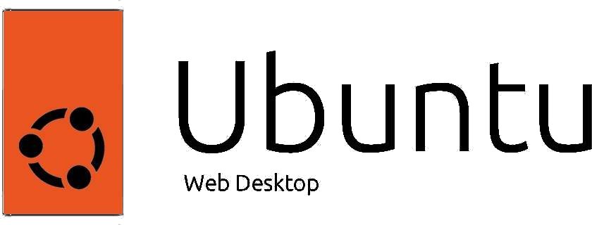

<div align="center">

<picture>
  <source media="(prefers-color-scheme: dark)" srcset="banner-light.png">
  <source media="(prefers-color-scheme: light)" srcset="banner-dark.png">
  
</picture>

<br><br>

<b><a href="https://github.io">🌐 Live Demo</a></b> &nbsp;•&nbsp; <code>🚧 Status: In Development</code> &nbsp;•&nbsp; <code>⚡ HTML5 | CSS3 | Vanilla JS</code>

</div>


</div>

---

## ◈ Overview

**Ubuntu Web Desktop** brings the look, feel, and command-line workflow of **Ubuntu 26.04 LTS (GNOME + Yaru Dark)** straight into your web browser—with **zero external frameworks, zero build tools, and zero dependencies**.

```text
╭──────────────────────────────────────────────────────────╮
│  ● ● ●   ubuntu@ubuntu: ~                                │
├──────────────────────────────────────────────────────────┤
│  $ neofetch                                              │
│  OS: Ubuntu 26.04 LTS x86_64 (Web Replica)               │
│  DE: GNOME Shell + Yaru-dark                             │
│  Terminal: Interactive + vim & nano built-in             │
╰──────────────────────────────────────────────────────────╯
```

---

## 🚀 Updates

### `v1.0` — Initial Public Release *(Latest)*
* **🌐 Live Web Deployment:** Hosted **Ubuntu Web Desktop** live on GitHub Pages with custom Light/Dark theme README banners.
* **⌨️ Interactive Terminal (`100+` Commands):** Added full command execution including `neofetch`, `sudo apt install`, `ls`, `cat`, `grep`, `systemctl`, and `help` with **Tab auto-completion** and `Ctrl+L` / `Ctrl+C` shortcuts.
* **📝 Built-in Terminal Editors:** Implemented working **`vim`** and **`nano`** text editors directly inside the terminal.
* **🖥️ GNOME Shell & Multitasking:** Built the Yaru Dark desktop layout, top-bar active app switcher, **Activities Overview** with workspace switching, and layered window management.
* **📂 Core Desktop Apps:** Added **Files** directory browser, **Settings** configuration panels, and an integrated **Media Player**.

---


---

## 🛠️ Tech Stack

```text
├── index.html   ──► Complete Desktop UI, Stylesheet (CSS3), & OS Logic (Vanilla JS)
```

* **Markup:** Semantic HTML5
* **Styling:** Custom CSS3 (Flexbox, Grid, GNOME/Yaru theming, custom animations)
* **Logic:** Pure Vanilla JavaScript (Window state manager, virtual shell parser, audio engine)

---

## 🗺️ Development Roadmap

* [x] GNOME Desktop layout, Dock, Top Bar & Activities Overview
* [x] Interactive Terminal with 100+ commands & Tab completion
* [x] Working `vim` and `nano` terminal editors
* [x] Settings & File Manager UI + Media Player
* [ ] Deep interactive file system & folder navigation
* [ ] Additional built-in apps (Browser, Calculator, Text Editor)
* [ ] More terminal Easter eggs & system utilities

---

## 🚀 Run Locally

Want to run or inspect the code offline?

1. **Clone or Download** `index.html` from this repository.
2. **Open** `index.html` in any modern desktop web browser (Chrome, Firefox, Edge, Brave).
3. *(Optional)* Press `F11` for an immersive full-screen Ubuntu experience!

---

<div align="center">

**Crafted with ❤️ over 3–5 months by [@Windowra](https://github.com)**

</div>
